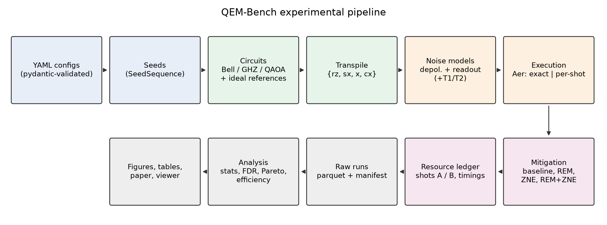
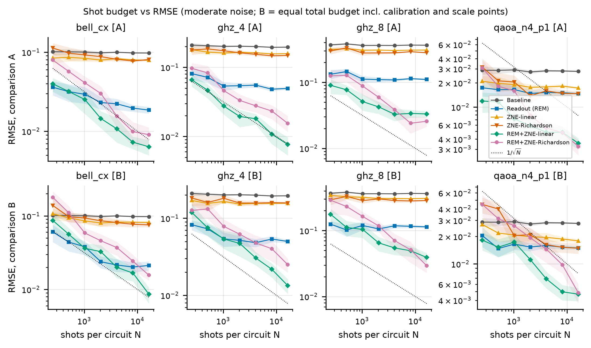

# QEM-Bench

**A resource-aware benchmarking framework for quantum error mitigation under noisy circuit execution.**

QEM-Bench measures what quantum error mitigation (QEM) actually costs. Every calibration circuit, every noise-scaled
execution and every shot is recorded in a resource ledger. Mitigation methods are compared under two explicit
accounting rules, using paired statistics, false-discovery-rate control and Pareto analysis.

> **Status:** research software v0.1.0. All results come from **simulations** (Qiskit Aer, phenomenological noise) and are
> not hardware measurements. The manuscript in `paper/` is an unreviewed draft and has not been submitted anywhere.

## Research motivation
Mitigation can lower the bias of an estimate, but it costs extra shots and adds variance. A method that halves the error
while using four times the shots may lose to an unmitigated estimator given those same shots. Accuracy alone is not enough to rank methods.

**Primary question.** How do mitigation techniques trade off estimation accuracy, statistical uncertainty, sampling
overhead and execution cost as circuit depth, noise intensity and measurement budgets increase?

RQ1 readout mitigation vs readout error · RQ2 ZNE vs depth and gate noise · RQ3 is REM+ZNE consistently better? ·
RQ4 constrained shot budgets · RQ5 cost without meaningful gain · RQ6 resource-aware ranking.
Hypotheses and pre-specified decision rules: [`docs/research/hypotheses.md`](docs/research/hypotheses.md).

## Main contributions (scoped; see `docs/research/research_gap.md`)
1. An open harness with an enforceable **resource-accounting validator**. Comparison A gives every method equal primary shots; comparison B gives every method an equal *total* budget, including calibration.
2. A dataset of 8,532 simulated conditions × 30 repetitions (255,960 estimates), with paired tests and BH-FDR control.
3. A dimensionless efficiency metric η, reported alongside the established improvement factor μ (Russo et al., 2023).
4. A documented pitfall: unweighted partial gate folding can mis-scale noise on small circuits (λ_eff = 1.18 or 2.93 for nominal 2). It is fixed by error-weighted folding plus extrapolation on the measured λ_eff.

## Features
| Layer | Implemented |
|---|---|
| Circuits | Bell (CX/CZ/depth-padded), GHZ (3–8 qubits), QAOA Max-Cut (n = 4, 6; p = 1, 2) with exact references |
| Noise | depolarizing 1q/2q, symmetric and asymmetric readout, optional T1/T2 relaxation, YAML-configurable sweeps |
| Mitigation | baseline · readout (full 2ⁿ or tensored calibration; condition-number checks) · ZNE (global/local folding; linear and Richardson; γ-variance propagation) · REM+ZNE |
| Accounting | shots per circuit / setting / scale / calibration; comparisons A and B; sampling, calibration and post-processing timings |
| Statistics | bias, MSE, RMSE, MAE, variance, bootstrap CIs, Wilcoxon + rank-biserial, permutation tests, BH and Holm |
| Analysis | efficiency η, μ, work-normalised MSE, Pareto frontiers, automated verdicts for H1–H5 |
| Outputs | Parquet raw data with schema version, SHA-256 manifests, 12 figures (PNG 300 dpi + PDF), LaTeX tables, web results viewer |

## Architecture


```
configs/ ─► config.py (pydantic) ─► circuits/ ─► execution/runner.py (transpile, fold) ─► execution/simulator.py (Aer)
        seeds.py ─────────────────────────────────────┤
mitigation/{baseline,readout,zne,combined} ◄──────────┤──► execution/resource_tracker.py (ledger A/B)
experiments/runner.py ─► results/<run>/{raw,circuits,zne_points}/*.parquet + manifest.json
analysis/{aggregation,comparisons,pareto,hypotheses} ─► visualization/* ─► results/figures, paper/, web viewer
```
Details: [`docs/architecture.md`](docs/architecture.md) · Methodology: [`docs/methodology.md`](docs/methodology.md)

## Installation
Requires Python 3.11 (tested on 3.11.18 with Qiskit 2.2.3 and Qiskit Aer 0.17.2).
```bash
git clone <repo-url> qem-bench && cd qem-bench
uv sync --extra dev                       # exact versions from uv.lock
# or: python -m venv .venv && . .venv/bin/activate && pip install -e ".[dev]"
```

## Quick start
```bash
make test                                             # 76 tests: unit, integration, scientific validation, reproducibility
python scripts/run_experiment.py --profile smoke      # about 2 s; writes results/pilot/smoke_<UTC>_<hash>/
python scripts/run_pilot.py                           # pilot: per-shot Aer vs exact sampling + timing study
python scripts/analyze_results.py --run data/reference/demo/run --out /tmp/demo_agg   # bundled demo data
```
`data/reference/demo/` is a small **demonstration subset** (clearly labelled) of the standard run. It lets you inspect the analysis
pipeline without running anything expensive.

## Reproducing the reported study
```bash
bash scripts/reproduce_all.sh          # pilot + standard + analysis + figures + validation (about 10 min, 4 cores)
python scripts/run_full_benchmark.py   # 'full' profile: 100 reps, larger grid — documented, NOT executed for the paper
```
Runs are never overwritten. A new run directory is `<profile>_<UTC>_<config-hash>`, and `--resume <run_dir>` continues an
interrupted run (resuming is refused if the configuration hash differs).

## Example results (standard run; simulated)
| Method | Median ΔRMSE vs baseline, A | Overhead (A) | Median ΔRMSE, B (equal budget) | μ > 1 (A) |
|---|---|---|---|---|
| REM | −60 % | 2.3× | −54 % | 84 % |
| ZNE-linear | −22 % | 3.0× | −19 % | 10 % |
| ZNE-Richardson | −22 % | 3.0× | −19 % | 18 % |
| REM+ZNE-linear | −81 % | 4.3× | −68 % | 89 % |
| REM+ZNE-Richardson | −74 % | 4.3× | −55 % | 77 % |

At 256 shots under an equal total budget, ZNE-Richardson was significantly *worse* than baseline in 17 % of conditions. Hypothesis
verdicts: H1 supported; H2 supported only through its budget component (ZNE did **not** deteriorate with noise in the tested range);
H3 supported; H4 **not supported** by the pre-specified pooled test; H5 supported in its weak form. Source:
`results/aggregated/standard/summary.json`.



## Web results viewer
A read-only dashboard (React + FastAPI) serves the saved aggregated data and figures: overview and verdicts, a condition explorer,
RMSE-vs-shots and Pareto charts, statistical tests, the figure gallery and reproducibility details. It only reads `results/aggregated/`.

## Limitations
Simulation only. The noise models are phenomenological and uncorrelated, which favours tensored REM and folding-based ZNE. The circuits are small (≤ 8 qubits)
and compiled without routing. There are 30 repetitions per condition, and the design is a reduced factorial (`full` is pending). Exponential extrapolation, PEC, CDR and M3 are
not implemented. The timings are machine-specific. See paper §8.

## Citation
See [`CITATION.cff`](CITATION.cff).
```bibtex
@software{gopalaswamy2026qembench,
  author = {Gopalaswamy, Nagarjun}, title = {QEM-Bench: A Resource-Aware Benchmarking Framework for Quantum Error Mitigation},
  year = {2026}, version = {0.1.0}, note = {Independent researcher}
}
```

## License
MIT. See [`LICENSE`](LICENSE).
